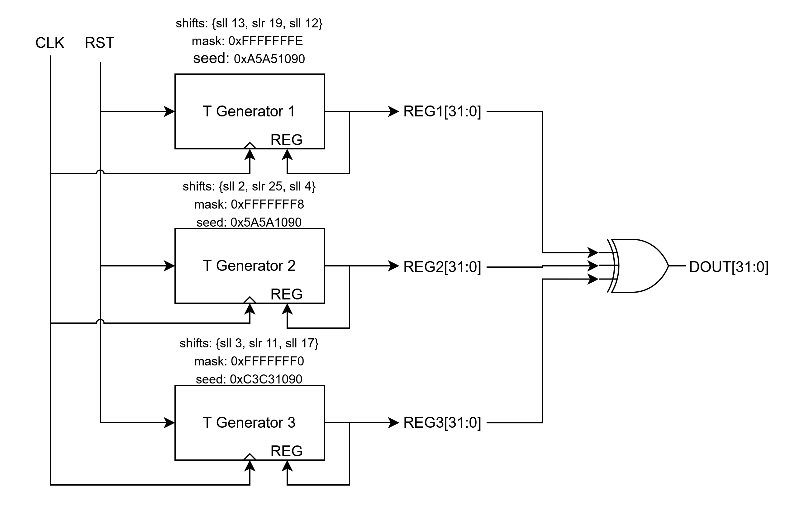
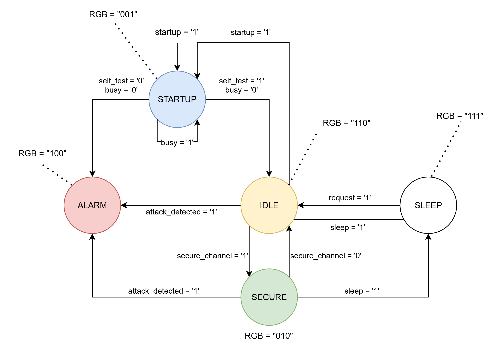
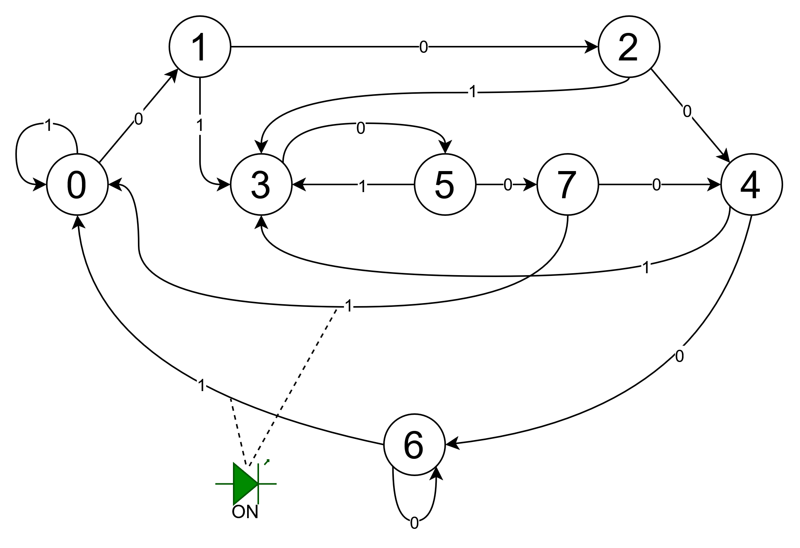
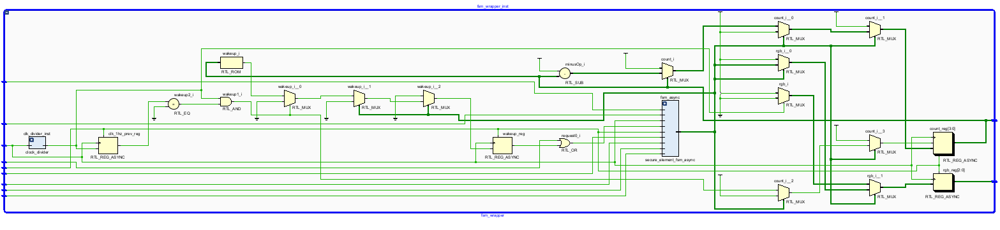
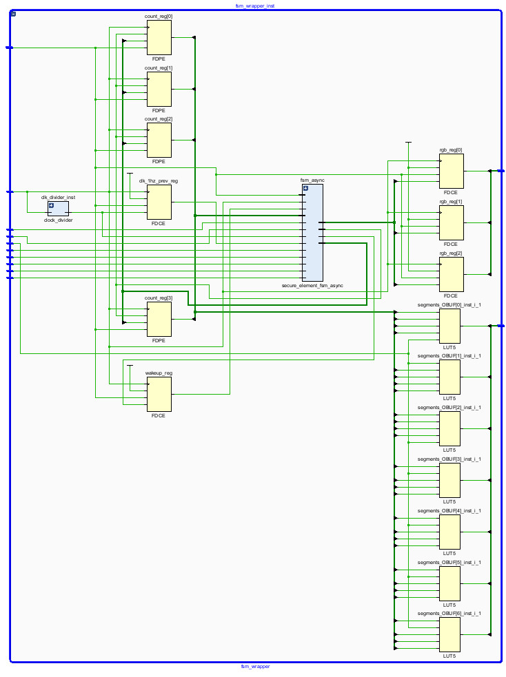
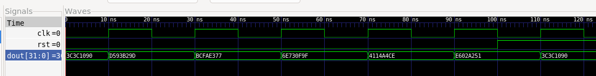

# ECE 410 Lab 2: Finite State Machines

Names: Dion Walton, Anahita Houshyar

CCIDs: ddwalton, ahoushya

Lab Section: D31

## Questions
1. What was the biggest obstacle you had to overcome while working on this lab, and how did you resolve it?
2. Compare the testing process using the logic analyzer with the behavioral simulation. How did the real-time
testing with the AD2 differ from the purely simulated environment, and what are the key benefits of using
the AD2/AD3 for testing your design? Were there any specific challenges or insights you gained from this
hands-on testing that were not apparent during simulation?
3. Propose potential enhancements to the pseudo random number generator design from Part 1, and briefly
justify each enhancement in 1 or 2 sentences.
4. Suggest other possible upgrades that could be added to the secure element to improve its functionality or
safety. Provide a brief explanation for each suggestion.
5. What trade-offs did you consider when deciding whether to use a Mealy or Moore FSM for the secure
element? How did this decision impact your design?


## Abstract
> Provide a summary of the lab objectives, design approach, and key results. The abstract should be no more than 150 words.

In this lab, we design, tested, and implement a pseudo-random number generator using a the Tausworthe generator architecture. Then, we design, tested, and implemented a 7-input, 3-output (RGB LED), 5-state Moore finite state machine (FSM) for a secure element chip. After creating the 5-state secure element FSM, it was enhanced by making the Zybo-Z7 development board flash a red on the RGB LED at 5 Hz in `ALARM_STATE`, and adding a 15-second wake-up timer to the sleep state, in which it would automatically go into the `IDLE_STATE` from `SLEEP_STATE`. Finally, a Mealy FSM was reverse engineered from a bitstream and reimplemented in VHDL.

> TODO: Results?

## Design
> Provide detailed explanation of your design process, including the following components:

#### Tausworthe Generator Design

The Tauseworthe generator consisted of 3 `taus88` submodules. Each submodule acts as a linear feedback shift register (LFSR), which is essentially a D Flip-Flop that does some combinational operation to determine the next register value. Using generics, each submodule is instantiated with a "seed" - the initial value held in the LFSR (`g_SEED`), 3 shift values (`g_SHIFT1`, `g_SHIFT2`, and `g_SHIFT3`), and a "mask" (`g_MASK`). The submodule then does the following computation (although, the code uses type casting and `shift_left()` / `shift_right()` functions instead of using the overloaded `SLL` and `SRL` operators for compliance with modern VHDL).

```vhdl
reg <= (((reg SLL g_SHIFT1) XOR reg) SRL g_SHIFT2) 
        XOR
        ((reg AND g_MASK) SLL g_SHIFT3);
```

Using 3 of these submodules initialized with different seeds, shift values, and masks and XORing their registers, we get a pseudo-random number generator (PRNG) that is updated on each CLK cycle. 

#### Secure Element FSM: Initial Design

The initial design of the secure element FSM is implemented as a Moore FSM, where the current output only depends on the current state. The state-transition diagram can be seen below in the "Truth Table & Functional Block Diagrams" section. This was done by creating a `secure_element_fsm.vhd` entity, with input ports being each of the 7 inputs, (`attack_detected`, `busy`, `self_test`, etc.) and output ports being the the RGB values that indicate the current state. The RGB values are directly mapped to an enumerated type that describe the state, where the transitions between states are defined in nested if-else blocks within a process. Simply put, a control signal `state` drives the output RGB based on the `transition` process on the rising edge of the clock. Additionally, this version of the FSM utilizes a synchronous reset, which only resets the state back to `STARTUP_STATE` on the rising edge of the clock while `rst` is held high.

The top-level module for the first iteration of the secure chip FSM (`fsm_top.vhd`) utilizes the `manual_clock` to drive the state transitions, so that testing on-board allowed more precise control.

#### Secure Element FSM: Upgraded Design

The upgraded design of the secure element FSM required 3 new features: an asynchronous reset, a blinking red LED on `ALARM_STATE`, and a 15-second timer that automatically transitioned the state from `SLEEP_STATE` to `IDLE_STATE` once it reached 0. To create the asynchronous reset, a second iteration of the FSM was created as `secure_element_fsm_async.vhd`. This has the same code, except the process now has `rst` in its sensitivity list (as opposed to just `clk`), while taking the `if (rst = '1')` out of the if statement for the `if rising_edge(clk) = '1'` and making the rising edge if an elsif. The change can be seen below:

```vhdl
transition : PROCESS(clk, rst)
    BEGIN
        IF rst = '1' THEN
            -- async reset
            state <= STARTUP_STATE;
        ELSIF (rising_edge(clk)) THEN
            -- do stuff
```

After adding the asynchronous reset, the remaining features were implemented by creating a higher-level entity (`fsm_wrapper.vhd`) that uses the FSM as a component. This higher-level entity takes in the control signals as input and plugs them into the ports of the FSM, while additionally having a secondary `wakeup` control signal that, if '1', acts like `request`, sending the state from `SLEEP_STATE` to `IDLE_STATE`. Additionally, the out ports of the are overridden with internal signals from the top-level entity to properly control the LED. 

The 1 Hz blinking LED was implemented by taking the output of the FSM (which is known due to the `rgb_fsm_out` being a one-to-one mapping to states) and toggling the actual LED between "000" (off) and "100" (red) based on a 1 Hz clock signal only if `rgb_fsm_out = "100"` (`ALARM_STATE`). The 1 Hz clock was obtained from a `clock_divider` component which uses the system clock of 125 MHz as input. The clock divider operates by counting up on each rising edge of the system clock until it reaches `125_000_000 / 2` clock cycles, where it subsequently toggles the output clock high or low. This results in an overall 1 Hz output clock. 

The counter was implemented by using the `IEEE.NUMERIC_STD` library, which allowed an 4-bit unsigned `count` timer to be subtracted by 1 each rising edge of the 1 Hz clock (or where the closest rising edge in line with the system clock is). Similarly to the red flashing led, we can reuse the same logic and only count down if the FSM is in `SLEEP_STATE`. Once the `count` signal reaches 0, the `wakeup` signal is asserted, overriding normal operation and putting the FSM into `IDLE_STATE`.

The top-level implementation uses the count signal as a port that drives a seven-segment display decoder (`display_controller`) by converting the hex value to binary encoded decimal to properly display the sleep countdown value in base-10.

#### Black Box Design

The black box is a reverse-engineered version of the provided `black_box.bit` bitstream file. We were able to determine that the original system had 8 total states (numbered 0-7). In each state, `SW0` (indicated on `LD0`) on the Zybo-Z7 board determines where the next state will be. This "next state" is then displayed on the LEDs `LD[1:3]`, and advanced to only when `BTN0` (`clk_en`) is pressed. 

To implement this, a look-up table for each state was created. The inputs for the look-up table were the current state, as well as the current input. This determined what the next state would be. Implementing the `clk_en` button for state advancement was much more difficult than a simple button debounce on a micro-controller. Since button presses have some transients and high frequency noise for some short time, the `clk_en` signal from the button had to be sampled at a lower frequency to avoid multiple edge detections. In code, we tuned the sampling frequency to be 10 Hz by counting to 12 500 000 (incrementing by one each system clock cycle). 10 Hz was chosen arbitrarily, as humans typically press buttons for longer than 1/10 seconds. However, this didn't get rid of the problems. Since button inputs are inherently in a different clock domain than the system clock, it is possible to get metastable signals (neither 0 nor 1). Hence, to account for this, a 2-stage synchronizer was used to ensure the possibly metastable input decayed towards 0 or 1 before incrementing the counter or using the signal to detect its rising edge.

### Calculations/Assumptions
> Clearly state any calculations performed and assumptions made during the design process.

#### Secure Element FSM Assumptions

For the secure element FSM, it was assumed that any state (aside from `SLEEP_STATE`) immediately goes into `ALARM_STATE` once `attack_detected` is asserted. Additionally, it was assumed that `ALARM_STATE > SECURE_STATE > STARTUP_STATE > SLEEP_STATE` in terms of precedence (i.e., if each signal were asserted at the same time, the FSM would go into `ALARM_STATE`). Finally, it was assumed that the `SLEEP_STATE` can only be left by asserting `request`, where it transitions into `IDLE_STATE`. 

#### Black Box Assumptions

For the "black box," it was assumed that the original code operated as a Mealy machine (inputs and state in conjunction controlling the current state). Although mathematically analogous, the Mealy implementation was far simpler to implement than a Moore machine due to the number of states it would require.

### Flowchart of the Design
> Include a flowchart that illustrates the overall design process or logic flow of your system.

### Truth Table & Functional Block Diagrams
> Provide a truth table for small designs or for internal blocks if the design is complex. This should outline the expected outputs for all possible inputs. Additionally, include a functional block diagram that illustrates the overall structure and major components of your design, showing how different blocks interact with each other.

#### Tausworthe Generator Block Diagram



#### Secure Element Chip FSM



#### Block Box FSM



#### Black Box Truth Table

| Current State (`curr_state`) | Input (`data_in`) / `SW0` = `LD0`| Next State (`next_state`) / `LD[1:3]` | Output (`seq_detected`) |
| --- | --- | --- | --- |
| 000 | 0 | 001 | 0 |
| 000 | 1 | 000 | 0 |
| 001 | 0 | 010 | 0 |
| 001 | 1 | 011 | 0 |
| 010 | 0 | 100 | 0 |
| 010 | 1 | 011 | 0 |
| 011 | 0 | 101 | 0 |
| 011 | 1 | 000 | 0 |
| 100 | 0 | 110 | 0 |
| 100 | 1 | 011 | 0 |
| 101 | 0 | 111 | 0 |
| 101 | 1 | 011 | 0 |
| 110 | 0 | 110 | 0 |
| 110 | 1 | 000 | 1 |
| 111 | 0 | 100 | 0 |
| 111 | 1 | 000 | 1 |

### Synthesized Schematic
> Include the schematic generated after synthesis, showing the actual hardware implementation of your design. If the schematic is too large, you may break it up into smaller, more manageable pieces for clarity.

#### Top-level FSM RTL Synthesis


#### `fsm_wrapper_inst` RTL Synthesis



#### `fsm_wrapper_inst` Elaborated Design



### Implementation
> Describe the implementation details, including pin assignments and any observations made on the board during testing

#### Tausworthe Generator Implementation

For the Tausworthe pseudo-random number generator, the implementation utilized an instantiation of the top-level design from `prng.vhd` in `taus88_top.vhd`. This implementation utilized a button-controlled manual clock to advance cycle through each clock cycle of the PRNG, essentially generating a new number each button press. Meanwhile, a byte counter takes in the generated number and displays put it in a byte-long section, while a display controller displays the byte-long section on the seven-segment display as hexadecimal.

#### Secure Element FSM Implementation

The secure element FSM required taking in control signals from the Analog Discovery 2 over a Pmod Port connection. To accomplish this, the constraints file needed to be modified (seen in `fsm_constr.xdc`). A table below shows the pin assignments that were required. The first version utilized `btn` (Pin `K17`) to manually advance the state, this was removed in the second version, instead using the system clock (`clock`). Both versions use a `start` signal from the button at pin `K18` as a reset signal. Both versions also use control RGB LED using the signal `rgb[2:0]`. Lastly, the improved version uses `segments[7:0]` that map to the pins that control the seven-segment display to show the current count in `SLEEP_STATE`.

| FPGA Pin | Signal Name | AD2 Signal | Description |
| --- | --- | --- | --- |
| **K17** | `clock` | — | System Clock (125 MHz) |
| **K18** | `start` | — | Start/Reset Button |
| **Y16** | `btn` | — | Advance State Button (For first version) |
| **V16** | `rgb[2]` | — | RGB LED 6 (Red) |
| **F17** | `rgb[1]` | — | RGB LED 6 (Green) |
| **M17** | `rgb[0]` | — | RGB LED 6 (Blue) |
| **V15** | `busy` | **D0** | Pmod JC Pin 1 |
| **W15** | `self_test` | **D1** | Pmod JC Pin 2 |
| **T11** | `startup` | **D2** | Pmod JC Pin 3 |
| **T10** | `sleep` | **D3** | Pmod JC Pin 4 |
| **W14** | `request` | **D4** | Pmod JC Pin 7 |
| **Y14** | `secure_channel` | **D5** | Pmod JC Pin 8 |
| **T12** | `attack_detected` | **D6** | Pmod JC Pin 9 |
| **T14** | `segments[6]` | — | Pmod JD Pin 1 (7-Segment Bit 6) |
| **T15** | `segments[5]` | — | Pmod JD Pin 2 (7-Segment Bit 5) |
| **P14** | `segments[4]` | — | Pmod JD Pin 3 (7-Segment Bit 4) |
| **R14** | `segments[3]` | — | Pmod JD Pin 4 (7-Segment Bit 3) |
| **V12** | `segments[2]` | — | Pmod JE Pin 1 (7-Segment Bit 2) |
| **W16** | `segments[1]` | — | Pmod JE Pin 2 (7-Segment Bit 1) |
| **J15** | `segments[0]` | — | Pmod JE Pin 3 (7-Segment Bit 0) |
| **H15** | `display_select` | — | Pmod JE Pin 4 (Digit / Display Select) |

#### Black Box Implementation

TO reimplement the black box, only the system clock, input from the switch, a `clk_en` button to advance the state, 4 single-color LEDs (`led[0:3]`), and a pin for the green RGB LED was required for `seq_detected`. A table can be seen below. The AD2 was not used for the black box.

| FPGA Pin | Signal Name | Description |
| --- | --- | --- |
| **K17** | `clock` | System Clock (125 MHz) |
| **G15** | `data_in` | Switch 0 (`sw[0]`) |
| **K18** | `clk_en` | Button 0 (`btn[0]`) |
| **M14** | `data` | LED 0 (`led[0]`) |
| **M15** | `leds[0]` | LED 1 (`led[1]`) |
| **G14** | `leds[1]` | LED 2 (`led[2]`) |
| **D18** | `leds[2]` | LED 3 (`led[3]`) |
| **F17** | `seq_detected`| RGB LED 6 Green (`led6_g`) |

## Simulation
> Document the simulation and results, including:

### Test Cases Table & Explanation
> Provide a brief explanation of the test cases used to verify the design, including the rationale behind each test and an explanation of edge cases used to verify the design.

#### Tausworthe Generator Test Cases

The Tausworthe PRNG did not require any complex test cases, instead its functionality was verified by generating a clock to cycle through each value of the LFSR and testing that the reset signal set the register back to initial value. Since each 

| Test Case | Expected Output | Actual Output | Pass / Fail | Description |
| --- | --- | --- | --- | --- |
| **Initialization** | `0x3C3C1090` | `0x3C3C1090` | This tests that the initial value is actually the XOR of the three initial register values of each LFSR. | Pass
| **Next Clock Edge** | `0xD593B29D` | `0xD593B29D` | Shows that the output actually changes on the rising edge to an unpredictable value according to the desired computation.| Pass
| **`rst='1'` on rising edge of clock** | `0x3C3C1090` | `0x3C3C1090` | This test verifies that the system resets to its initial state when reset is held high (synchronous reset).| Pass |

#### Secure Element FSM Test Cases

| Test Case | Expected Output | Actual Output | Pass / Fail | Description |
| --- | --- | --- | --- | --- |
| **Test 1** | `rgb = "001"` | `rgb = "001"` | Pass | Transition `rst` -> `startup`: System enters startup state |
| **Test 2** | `rgb = "100"` | `rgb = "100"` | Pass | Transition `startup` -> `alarm`: Failed self-test triggers alarm state |
| **Test 3** | `rgb = "001"` | `rgb = "001"` | Pass | Transition `alarm` -> `startup`: Reset clears alarm to startup state |
| **Test 4** | `rgb = "110"` | `rgb = "110"` | Pass | Transition `startup` -> `idle`: Successful self-test transitions to idle state |
| **Test 5** | `rgb = "111"` | `rgb = "111"` | Pass | Transition `idle` -> `sleep`: Sleep signal transitions FSM to sleep state |
| **Test 6** | `rgb = "110"` | `rgb = "110"` | Pass | Transition `sleep` -> `idle`: Request signal wakes FSM to idle state |
| **Test 7** | `rgb = "001"` | `rgb = "001"` | Pass | Transition `idle` -> `startup`: Startup signal returns FSM to startup state |
| **Test 8** | `rgb = "110"` | `rgb = "110"` | Pass | Transition `startup` -> `idle`: Successful self-test returns to idle state |
| **Test 9** | `rgb = "100"` | `rgb = "100"` | Pass | Transition `idle` -> `alarm`: Attack detection triggers alarm state |
| **Test 10** | `rgb = "001"` | `rgb = "001"` | Pass | Transition `alarm` -> `startup`: Reset signal clears alarm state to startup |
| **Test 11** | `rgb = "110"` | `rgb = "110"` | Pass | Transition `startup` -> `idle`: Successful self-test enters idle state |
| **Test 12** | `rgb = "010"` | `rgb = "010"` | Pass | Transition `idle` -> `secure`: Secure channel request enters secure state |
| **Test 13** | `rgb = "111"` | `rgb = "111"` | Pass | Transition `secure` -> `sleep`: Sleep signal from secure state enters sleep state |
| **Test 14** | `rgb = "110"` | `rgb = "110"` | Pass | Transition `sleep` -> `idle`: Request signal wakes FSM back to idle state |
| **Test 15** | `rgb = "010"` | `rgb = "010"` | Pass | Transition `idle` -> `secure`: Secure channel asserted enters secure state |
| **Test 16** | `rgb = "110"` | `rgb = "110"` | Pass | Transition `secure` -> `idle`: De-asserting secure channel returns to idle state |
| **Test 17** | `rgb = "010"` | `rgb = "010"` | Pass | Transition `idle` -> `secure`: Re-asserting secure channel enters secure state |
| **Test 18** | `rgb = "100"` | `rgb = "100"` | Pass | Transition `secure` -> `alarm`: Attack detected in secure state triggers alarm |

#### Black Box Test Cases

| Test Case | Expected Output | Actual Output | Pass / Fail | Description |
| --- | --- | --- | --- | --- |
| **Test 1** | `data = '0'`, `leds = "001"` | `data = '0'`, `leds = "001"` | Pass | Initial state: verified data pass-through and `next_state = 001` |
| **Test 2** | `leds = "001"` | `leds = "001"` | Pass | Glitch rejection: short pulse on `clk_en` ignored by debounce counter |
| **Test 3** | `leds = "010"` | `leds = "010"` | Pass | Transition state `000` -> `001`: debounced `clk_en` advances state |
| **Test 4** | `leds = "100"` | `leds = "100"` | Pass | Transition state `001` -> `010`: debounced `clk_en` advances state |
| **Test 5** | `leds = "110"` | `leds = "110"` | Pass | Transition state `010` -> `100`: debounced `clk_en` advances state |
| **Test 6** | `leds = "110"` | `leds = "110"` | Pass | Transition state `100` -> `110`: debounced `clk_en` advances state |
| **Test 7** | `data = '1'`, `leds = "000"`, `seq_detected = '1'` | `data = '1'`, `leds = "000"`, `seq_detected = '1'` | Pass | Sequence detection: combinatorial check in state `110` with `data_in = '1'` |
| **Test 8** | `seq_detected = '0'` | `seq_detected = '0'` | Pass | Transition state `110` -> `000`: clock pulse clears sequence detection flag |
| **Test 9** | `leds = "000"` | `leds = "000"` | Pass | Hold state `000`: `data_in = '1'` maintains current state at `000` |

### Simulation Results
> Include figures and waveforms from the simulation, accompanied by a brief explanation of the observed results and their significance.



[fig. 1] The above figure are the simulation results of the Tausworthe PRNG. As can be seen during initialization ($t=0$), the last 4 hex digits contain my student ID (176**1090**), which is expected as XORing 3 registers with `0x1090` as their LSBs results in `0x1090` in the output's LSB. It can also be seen at the end that the reset signal `rst` makes the output `dout[31:0]` the same as it's initial value.

> TODO: MORE SIM RESULTS


## Results 
> Present the results of your implementation, comparing them with expected outcomes. Discuss any discrepancies and analyze the performance of the design.

Tausworthe PRNG: The PRNG simulation was checked based on three things: the initial output, its update after clock edge, and how it response to reset. In the initialization stage the three Tausworthe registers load their seed values and their XOR produced the initial 32-bit output, 0x3C3C1090. After the rst changes from 1 to 0 the output changes and updates on successive rising clock edges. When reset is asserted, the generator returns to those starting values and the sequence begins again.
| Test case | Expected result | Observed result |
|---|---|---|
| Initial state | `0x3C3C1090` | `0x3C3C1090` |
| First update after a rising clock edge | `0xD593B29D` | `0xD593B29D` |
| Reset asserted at a rising clock edge | Output returns to `0x3C3C1090` | Output returned to `0x3C3C1090` |

All three test cases matched their expected results.

Secure Element FSM Results: This section was simulated to verify the FSM transitions between the startup, idle, secure, sleep, and alarm states. The RGB outputs identify the current state. `001` for startup, `110` for idle, `010` for secure, `111` for sleep, and `100` for alarm. In the simulation, the observed RGB output matched the expected output in all 18 test cases.
| State | RGB output | Indicated state |
|---|---|---|
| Startup | `001` | Blue |
| Idle | `110` | Yellow |
| Secure | `010` | Green |
| Sleep | `111` | White |
| Alarm | `100` | Red |

All 18 test cases passed, with no differences between the expected and observed outputs.

Upgraded Secure Element FSM Results: The upgraded FSM was evaluated for its asynchronous reset, alarm LED flashing, and sleep countdown.

| Feature | Expected behavior | Observed behavior |
|---|---|---|
| Asynchronous reset | Return to startup when reset is asserted, without waiting for a clock edge | The FSM returns to startup when reset is asserted |
| Alarm indicator | Flash the red LED at 1 Hz while in the alarm state | The LED alternates between red (`100`) and off (`000`) |
| Sleep countdown | Count down from 15 and wake the FSM to idle | the wakeup signal returns the FSM to idle |

Sequence Detector Results: It was simulated to check its state transitions, data pass-through, sequence detection, and rejection of short clk_en pulses. The design has eight states, and the LEDs show the next state. No discrepancies were observed in these tests. The initial test confirmed that `data_in = '0'` passed through to `data` and that the LEDs displayed `001`.  The detector then advanced through the tested states: `000` to `001`, `001` to `010`, `010` to `100`, and `100` to `110`, with the LEDs showing the expected outputs at each step.

For sequence detection, when the detector was in state `110` and `data_in = '1'`, the output became `data = '1'`, the LEDs displayed `000`, and `seq_detected` was changed to 1. After the detector moved to state `000`, `seq_detected` returned to `0`.The observed results matched the expected results in all nine tests.


## Conclusion
> Summarize the outcomes of the lab, including any challenges encountered and how they were addressed. Discuss the effectiveness of the design and any potential improvements.

In this lab we worked on designing and testing a Tausworthe pseudo-random number generator, a secure element FSM, upgrades to the FSM, and a reverse-engineered sequence detector. The simulation results matched the expected outputs for all three PRNG tests, all 18 secure element FSM tests, and all sequence detector tests. 
The hardest part was making sure each `clk_en` button press advanced the sequence detector only once. The FSM requirements also needed clarification through repeated design updates. For the PRNG, the SRL and SLL operators did not work as expected with STD_LOGIC_VECTOR, so we used shift_right and shift_left with unsigned type conversions. 
The setup could be improved by using secure cables to connect the Zybo board and breadboard to the Analog Discovery 2 oscilloscope, since loose connections made the setup less reliable.


## References
> Cite any references used during the lab, including textbooks, websites, articles or AI Assistants.

## Team Contribution
> Clearly indicate the specific contributions made by each team member in the lab, including design, simulation, implementation, and report writing.

